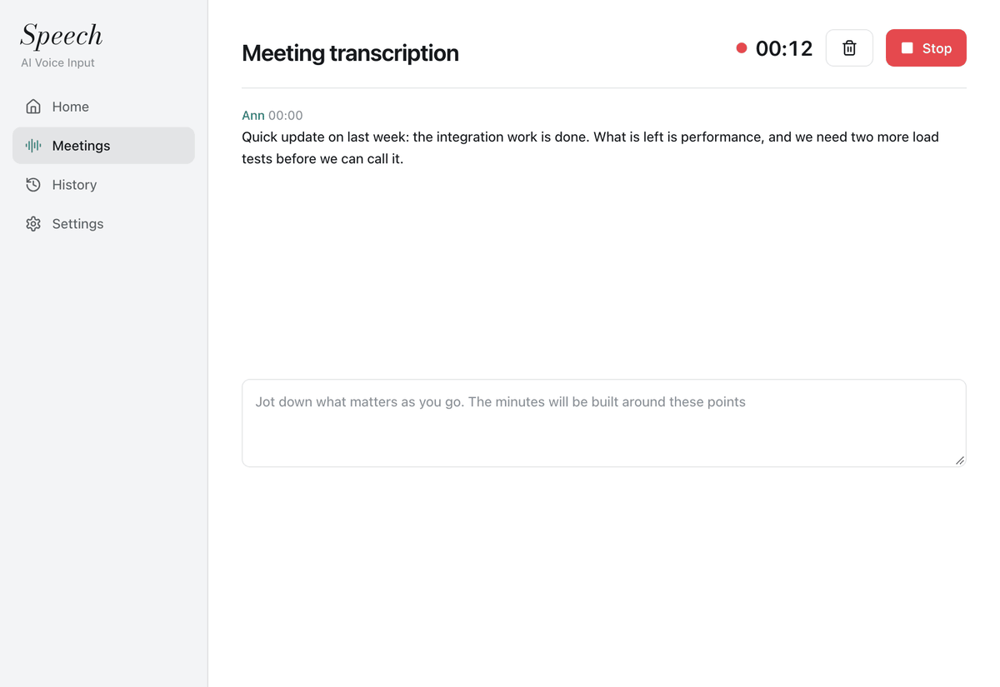
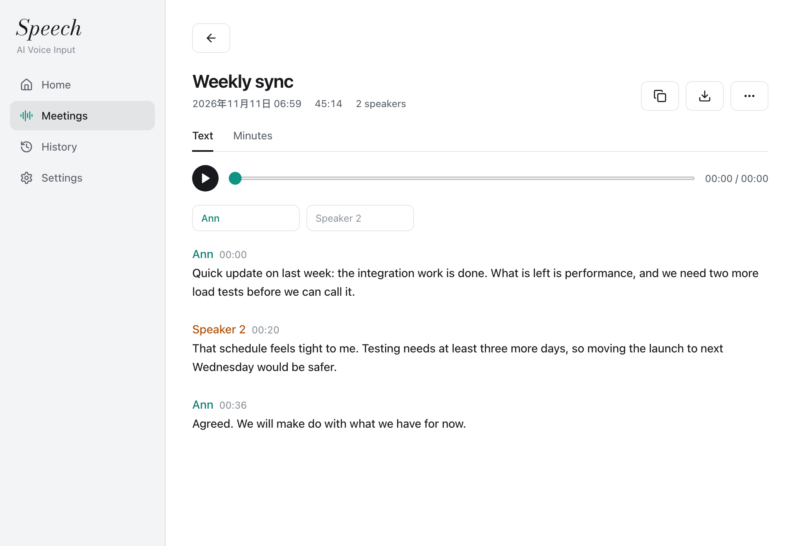

<p align="center">
  <strong>English</strong> | <a href="README_zh.md">中文</a>
</p>

<p align="center">
  
</p>

<h1 align="center">Speech, dictation and meeting notes on your own machine</h1>

Hold a hotkey, speak, and the text is typed into the app you are using. Speech recognition runs on your computer. Only the recognized text goes to a language model for cleanup, and you choose that model and supply its key.

Speech is a fork of [OpenTypeless](https://github.com/tover0314-w/opentypeless) (MIT). The hosted service, accounts and paid plans of the original are removed.

## What it does

- **Dictation into any app.** Hold or tap the hotkey, speak, release. The text is inserted at the cursor.
- **Cleanup by a language model.** Filler words, false starts and spoken self-corrections are removed, and several points become a list. Polish can be switched off; then the recognized text is inserted as it is.
- **Rewrite selected text by voice.** Select text, speak an instruction, and the selection is replaced.
- **Ask a question by voice** and get a short answer in a floating note.
- **Translation** of what you say into one or more target languages.
- **Scenes and per-app writing style**, with your own prompt templates.
- **A personal dictionary** with file import.

## Meetings

<p align="center">
  
</p>

The Meetings page records a meeting, or takes an audio or video file you choose or drop in (mp3, m4a, wav, flac, ogg, mp4, mov, mkv, up to 3 hours), and the recognizer chosen under Speech recognition in Settings turns it into text: the model on this machine, or the speech service you chose for dictation.

- **Words as they are said.** A guess at the words being said appears in grey about every second and is replaced by the settled words at the first pause after six seconds of talk, or after 20 seconds without a pause. A slow machine guesses less often or not at all. A stretch that cannot be recognized is tried again and then passed over, and the rest is still written out.
- **Corrections while it runs.** Click the settled words to change them, during the meeting or afterwards. A word you put right goes into the dictionary, and the recognizer listens for it for the rest of the meeting.
- **Languages.** Name up to three languages the meeting is held in, before or during the recording; with none named the model tells the language itself.
- **Speakers.** "Tell speakers apart" is on once its models are installed; each paragraph carries who spoke and when, each speaker in a colour of their own. The first time, three models totalling 143 MB are downloaded inside the app. In a file, one model (NVIDIA Nemotron-3-Diarization) follows up to eight speakers through the whole recording, so a person keeps one number from the first minute to the last; a recording still running is split window by window.
- **Speakers put right.** Double-click a speaker's name to give that paragraph, or all that speaker said, to someone else, or to name them. Click the number of people and type how many met: the speakers beyond that number are joined to the ones they sound most like. A speaker who said next to nothing and sounds like another is joined to that other when the text is done. Paragraphs of one speaker in a row show the name once.
- **Voices remembered by name.** Give a speaker a name and the app remembers that voice on this machine; the same person gets the name in later meetings. Remembered voices are listed under Options and can be removed.
- **Your own side of a call.** With the computer's sound recorded, the speaker heard by the microphone alone while the others come from the computer is named "Me", unless that voice already has a name.
- **From a word to its moment.** Click a word of a recorded meeting and the sound moves there; while it plays, the paragraph shows how far it has got. The time of a word is worked out from the times of the pieces around it, to within a few seconds. With "Exact word times" switched on, the kept sound is heard once more after the recording by a second recognizer that tells the time of each word (SenseVoice small, under the FunASR model licence, in the form sherpa-onnx loads; a 240 MB download the first time), and its times are matched to the words already written. This runs on this machine; ten minutes of sound take about twenty seconds on an Apple M-series chip.
- **Graphics processor on Windows.** The Windows build runs the recognizer on the graphics processor through Vulkan, a built-in one included. Where the model does not load there, or the worker fails while using it, the app has the worker do without and goes on with the processor alone. After five minutes it tries the graphics processor again and stays with it if that holds; each failure in a row doubles the wait, up to an hour.
- **A file that is hard to hear.** A stretch where the recognizer's words begin to repeat gives what was heard before that; a piece that cannot be heard at all is left out and the rest goes on, and only three such pieces in a row end the file. What was written of a file that could not be finished is kept as a meeting. Hearing may take twenty times the length of the sound before a slow machine is taken to be stuck.
- **Stopping a file.** While a file is written out, the square button lets it be: it ends before its next piece, what is written so far is kept as a meeting, and files that waited are left. A meeting that was being written out anew stays as it was.
- **Subtitles.** A text that carries times can be saved as SRT or WebVTT, one subtitle for each piece with the speaker's name, besides plain text, Markdown and Word.
- **No words nobody said.** On noise or silence a recognizer sometimes writes the same words over and over; a phrase written three times running, or one sound eight times, is kept once.
- **A long file in parts.** A file is written out eight minutes at a time, and each part shows as soon as it is done, with steps ticked off, a bar and the time left; the speakers of the whole file are told apart first, in one go.
- **Several files at once.** Drop or pick several recordings and they are turned into text one after another, each kept as a meeting of its own.
- **Both sides of a call.** With "Include computer sound" on, what the computer plays is recorded together with the microphone (macOS 14.6 or Windows 10 and later).
- **Devices can change mid-recording.** When the microphone goes away or another one takes over, the recording goes on with that one, the time without a microphone is silence and the computer's sound is still recorded; when the sound moves to headphones or back to the loudspeakers, the recording of it moves along.
- **The others are not recorded twice on loudspeakers.** In a meeting played through loudspeakers, what the microphone hears only from them is turned down; with headphones on this step is skipped (headphones are detected on macOS).
- **Audio kept with the meeting.** It can be played in the app; words the sound has not reached yet are grey, in lines set out with points and bold words as well, a click on words moves the sound there, a click on a time plays from there, and it can be saved elsewhere or transcribed again as a whole, which writes the same meeting out anew and leaves it as it was if that fails. Copied text, plain text, Word and subtitles leave out the marks around bold words; Markdown keeps them. It stays until you delete the audio or the meeting.
- **Minutes and questions.** "Write minutes" fills in a template, one that comes with the app (general, by chapter, one-on-one, interview, talk, stand-up), a Markdown or text file you import, or one you write in the app. The templates are laid out as small pages to pick from, with "New template" and "Import template" beside them; the same gallery opens from the list of meetings. Each meeting in the list has a button that makes its minutes in one go: pick a template, confirm, and the kept sound is written out anew (a tick you can clear), the words are put right, the speakers are checked and the minutes are written, each step ticked off in that row with the time left. Each step's result is kept as it ends, so a step that fails loses nothing of the ones before. Notes you type during the meeting steer the minutes; each line is marked with the moment it was begun at, and afterwards leads to that place in the recording. A recording can be paused and gone on with. Minutes scale with the meeting, tell decisions from discussion, list tasks as boxes to tick, and give the time of a decision or task, which leads to that moment of the recording. You can change the minutes by hand. You can also ask a question about a meeting, search past meetings by what was said in them, and ask a question of the newest twenty together.
- **Tidy-up and title.** The star button has the polish model put the whole text right in steps: first the words (misheard words, punctuation, sentence breaks, filler sounds, words said twice, false starts) with the spellings in your dictionary, and set out tidily (numbers, dates, amounts and percentages in digits, a space between Chinese and Latin text, points a speaker counts off begun with ①②③ each on its own line, and one or two phrases that carry a decision, a deadline or a figure in bold; double-click such a line to change it as it is written; a day named from the meeting day, such as "next Wednesday", gets its date in brackets after it, reckoned from the day the meeting began; a long paragraph that moves to another subject is begun anew there, under the same speaker and at the time those words were said), then, where speakers are told apart, who said what by the sense of it, moving a half-sentence that stands with the wrong speaker without changing a word. Each step is ticked off as it ends, with a bar and the time left, in the list of meetings as well; it goes on while you use other pages. What was taken out shows struck through in grey and what was added in the accent colour; the ⋯ menu puts the text back. Terms the model could not be sure how to spell are listed once: type the spelling, and it is written that way throughout and kept in the dictionary. A dictionary of more than eighty words is first picked from by what the meeting is about. Tidy-up can run by itself when a recording ends. A meeting you have not named is named by the polish model from its text: all of a short meeting, and the beginning, middle and end of a long one.
- **Live translation.** With "Translate live" on, each settled paragraph is translated and shown under the original.
- **Export.** Text and minutes can be saved as plain text, Markdown or a Word document. In copied and saved text, paragraphs that follow one another from the same speaker stand under one heading.

<p align="center">
  
</p>

Speaker separation and voice matching run on this machine. Recognition follows the choice under Speech recognition in Settings: with a model on this machine nothing is sent; with a speech service the sound of the meeting, the other participants' voices included, goes to that service a piece at a time, and a cloud mark stands on the Meetings page. Minutes, questions, tidy-up and live translation send the meeting text, and the notes you typed, to the polish model chosen in Settings; minutes also carry the newest eighty words of your dictionary, tidy-up carries up to eighty (picked by the polish model from the newest thousand, together with the beginning, middle and end of the meeting, when there are more), and its check of the speakers sends the text with the speaker numbers, and a question asked of all meetings sends the minutes, or the beginning of the text, of the newest twenty. With a polish model set up, up to 6,000 characters of a finished meeting (all of a short one; the beginning, middle and end of a long one) are also sent to it once, for the title. With no polish model set up, no meeting text leaves the machine. A recording that is cut short, for instance by a crash, is brought back the next time the app starts, with what was written down of it and the notes typed during it. The app keeps a log of states and errors in its data folder (Settings shows it); the log never holds what was said or typed. Once minutes are written, the title is written again from them, unless you typed one. Opening the model list in Settings times each listed model with a one-word request, shows the time beside it, and puts the list in order of the times. Words from your dictionary are given to the recognizer as words to expect, and a recording goes on while you use other pages.

## What this fork adds

- **Speech recognition on the machine.** Models are downloaded from the settings page with one click and checked against a SHA-256 before use. Recognition runs in a separate worker process that exits when idle.
- **Context for the recognizer.** The newest 30 dictionary words, your last few dictations in the same app (kept in memory for 10 minutes) and up to 200 characters before the cursor are given to the local recognizer. Text read from the screen is never sent to a cloud service.
- **Learning from your edits.** After a dictation the app watches the text field for up to a minute. A word you correct by hand is added to your dictionary together with what it was misheard as. Password fields are not read, and the text of the field is compared in memory and not stored.
- **Layout habits per app.** If you keep deleting the final period or joining lines in one app, polish stops adding them there. Only counts are stored.
- **Only my voice.** An optional filter keeps the enrolled speaker and removes other talkers before recognition. It uses the VoxLock model (Apache-2.0) through sherpa-onnx and needs a voice sample of at least 3 seconds, which stays on the machine.
- **Microphone handling.** Pick a microphone, switch automatically when the chosen one is silent, and mute the computer's sound output while recording (macOS).
- **A fallback polish model**, tried once when the main model fails.

## Local models

| Model                        | Size    | Notes                                           |
| ---------------------------- | ------- | ----------------------------------------------- |
| Qwen3-ASR 1.7B (Q8)          | 2.19 GB | Recommended. Best for mixed Chinese and English |
| Qwen3-ASR 0.6B (Q8)          | 850 MB  | Smaller and faster, weaker on English terms     |
| Qwen3-ASR 1.7B (F16)         | 4.09 GB |                                                 |
| MOSS Transcribe Diarize (Q8) | 987 MB  |                                                 |
| Cohere Transcribe (Q8)       | 2.41 GB |                                                 |
| Voxtral Mini 4B (Q8)         | 4.73 GB |                                                 |
| Nemotron 3.5 0.6B (Q8)       | 751 MB  |                                                 |

On 76 held-out recordings of real dictation, mostly Chinese with English terms, Qwen3-ASR 1.7B scored a character similarity of 0.83 against the reference text and recalled 91 of 122 technical terms. On an Apple Silicon laptop a 6 second recording is recognized in about 0.7 seconds and a 12 second one in about 1.3 seconds.

Cloud recognition from the original app still works with your own key: Deepgram, AssemblyAI, Aliyun Qwen3 ASR, Volcengine Doubao, GLM ASR, OpenAI Whisper, Groq Whisper, SiliconFlow, any OpenAI-compatible Whisper server, and Apple Speech on macOS.

## Polish models

Polish works with any service that speaks OpenAI Chat Completions, OpenAI Responses or Anthropic Messages. Presets are included for Zhipu, DeepSeek, SiliconFlow, OpenAI, Gemini, Moonshot, Doubao, Qwen, Groq, Claude, OpenRouter and Ollama. With Ollama nothing leaves the machine.

## What leaves the machine

| Data                                                | Where it goes                                                         |
| --------------------------------------------------- | --------------------------------------------------------------------- |
| Audio, of dictation and of meetings                 | Nowhere with a local model. To the speech service you chose otherwise |
| Recognized text                                     | To the polish model you configured. Nowhere when polish is off        |
| Text before the cursor, text read back from a field | Nowhere. Used by the local recognizer and for learning, in memory     |
| Voice sample, dictionary, history, settings         | Stored on the machine                                                 |
| API keys                                            | In the system keychain or credential manager                          |

There is no account and no telemetry. At launch the app asks GitHub whether a newer release exists; this can be switched off under Settings, About.

## Updates

The app checks for a newer release when it starts and says so in a bar at the top of the window. Settings, About can switch that off and has a button to check by hand. On Windows the app downloads only the program files that changed, checks each against the SHA-256 the release lists and replaces them, showing the progress. The new version takes effect when you press Restart. Models, settings and history are not touched. On macOS the button opens the release page, where the `.dmg` is downloaded and the app dragged onto Applications.

The home page shows the tokens the polish model reports using: today, the last 30 days and in all. The counts are kept on this machine and stay hidden when the provider reports none.

Dictionary, Snippets holds phrases and their text: say a phrase by itself and its text is entered exactly as written, without going to the polish model.

On macOS the app watches how you edit what you dictated: swapping the polite and plain Chinese "you", removing exclamation marks, opening or closing the space between Chinese and Latin text, dropping the final period, joining lines. Once the same edit has been made five times in one app, polish follows it there. Only counts are stored, never text, and each habit can be forgotten on the Dictionary page.

Settings, AI Polish, Advanced polish settings chooses the Chinese script (Simplified or Traditional) and the punctuation (automatic, only marks said aloud, or none). Settings, General, More settings has writing while the model generates, clipboard and history retention choices, and three more hotkeys: rewrite the selection by voice, switch scene, open the main window. Settings, About has a status check.

## Platforms

| Platform               | State                                                                                                                                                         |
| ---------------------- | ------------------------------------------------------------------------------------------------------------------------------------------------------------- |
| macOS, Apple Silicon   | In daily use. Local recognition uses Metal                                                                                                                    |
| Windows 10 and 11, x64 | Installer and no-install archive in the releases. Local recognition runs on the CPU. Reading text fields back and muting sound output are not implemented yet |
| Linux                  | The original app supports it. The additions of this fork have not been run there                                                                              |

## Build from source

Requirements: Node 20, Rust 1.82 or newer, CMake, and the [Tauri 2 prerequisites](https://tauri.app/start/prerequisites/) for your system.

```bash
npm ci
npm run tauri dev      # run in development
npm run tauri build    # build the app
```

The build compiles the speech worker (`stt-worker/`) first and bundles it with the app. It downloads a prebuilt sherpa-onnx library for the voice filter.

On macOS, sign the build with a stable identity so that the Accessibility and Microphone permissions survive a rebuild:

```bash
APPLE_SIGNING_IDENTITY="<your identity>" npm run tauri build -- --bundles app
```

Tests:

```bash
npm test
cargo test --manifest-path src-tauri/Cargo.toml --lib
(cd stt-worker && cargo test)
```

## First run

1. Install it. On macOS open the `.dmg` and drag the app onto Applications; a newer version is installed the same way and keeps its permissions. On Windows run the installer.
2. Open the app and follow the guide: grant Microphone and Accessibility, then download a local model.
3. Enter the base URL and key of a polish model under Settings, AI Polish, and press Test.
4. Read the sample sentence in the last step of the guide. With local recognition this reading is kept as your voice sample.
5. Hold the hotkey in any app and speak.

## License

MIT, as the original project. See [LICENSE](LICENSE) and [THIRD_PARTY_NOTICES.md](THIRD_PARTY_NOTICES.md).
