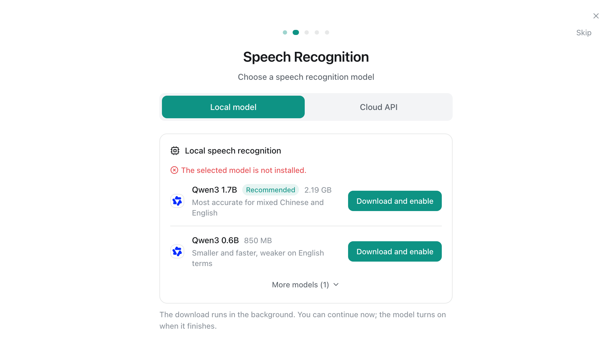
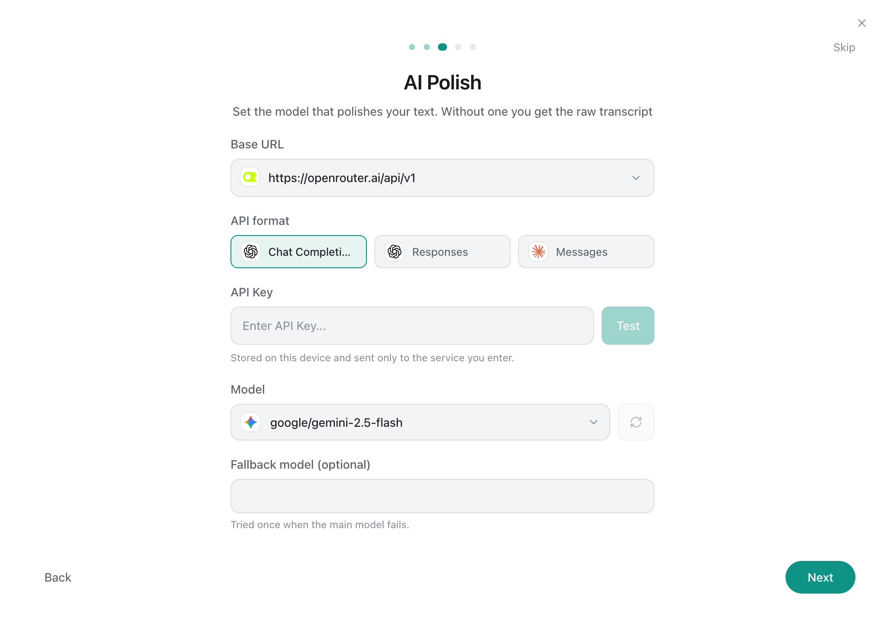
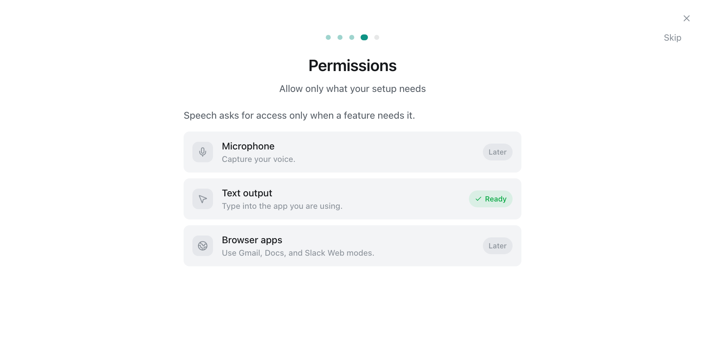
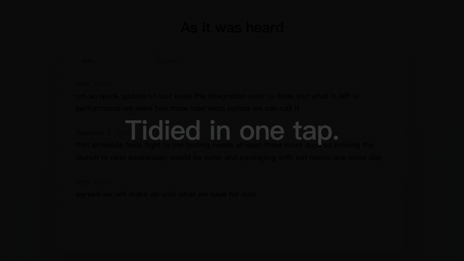
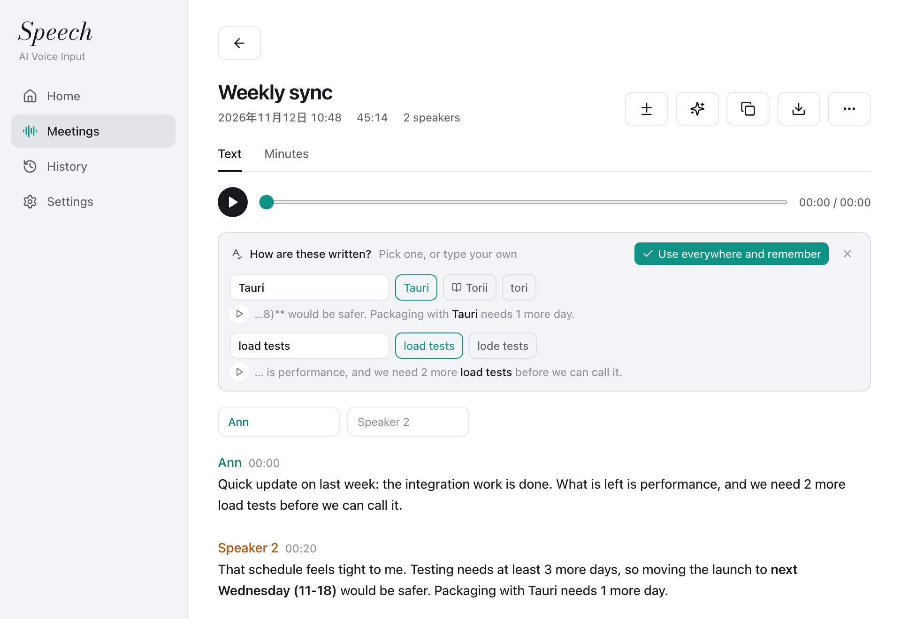
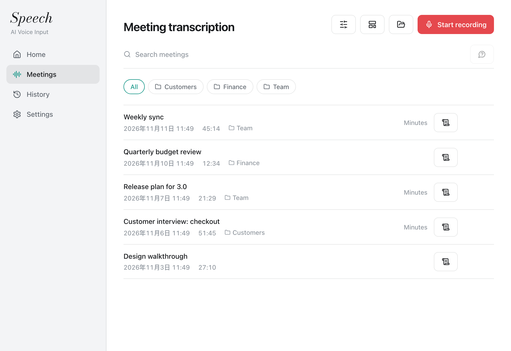

<p align="center">
  <strong>English</strong> | <a href="README_zh.md">中文</a>
</p>

<p align="center">
  
</p>

<h1 align="center">Speech</h1>

<p align="center">Dictation and meeting notes that run on your own machine.</p>

<p align="center">
  <a href="https://github.com/PenguinMiaou/Speech/releases/latest/download/Speech-macos-arm64.dmg"><strong>Download for macOS</strong></a>
  |
  <a href="https://github.com/PenguinMiaou/Speech/releases/latest/download/Speech-windows-x64-setup.exe"><strong>Download for Windows</strong></a>
</p>

<p align="center">
  
</p>

Hold a hotkey, speak, and the text is typed into the app you are using. Speech recognition runs on your computer. Only the recognized text goes to a language model for cleanup, and you choose that model and supply its key. No account, no telemetry.

## Get started

### 1. Install

|         |                                                                                                                                                                     |
| ------- | ------------------------------------------------------------------------------------------------------------------------------------------------------------------- |
| macOS   | Open [the `.dmg`](https://github.com/PenguinMiaou/Speech/releases/latest/download/Speech-macos-arm64.dmg) and drag Speech onto Applications. Apple Silicon.         |
| Windows | Run [the installer](https://github.com/PenguinMiaou/Speech/releases/latest/download/Speech-windows-x64-setup.exe), or unpack the portable archive from the release. |

Later versions install from inside the app.

### 2. Pick a speech model

The guide opens on first launch. Press **Download and enable** on the recommended model; it runs on your machine from then on.

<p align="center">
  
</p>

### 3. Connect a polish model

Choose a service, paste its key and press **Test**. Any service that speaks OpenAI Chat Completions, OpenAI Responses or Anthropic Messages works; with Ollama nothing leaves the machine. Skip this step and the recognized text is typed as it is.

<p align="center">
  
</p>

### 4. Allow the microphone and text output

<p align="center">
  
</p>

### 5. Hold the key and speak

Put the cursor anywhere, hold the hotkey shown on the Home page, speak, release.

<p align="center">
  
</p>

Filler words and false starts are removed, and a sentence said in the order it was thought of is put in the order it would be written. You can also rewrite selected text by voice, ask a question, or have what you say translated.

## Meetings

### Record, or drop in a file

Open **Meetings** and press **Start recording**, or drop audio or video files onto the page. Words appear as they are said, each paragraph under the speaker's name.

<p align="center">
  
</p>

### Tidy the text in one tap

The star button has the polish model put the whole text right. The button beside it shows what changed.

<p align="center">
  
</p>

### Settle the terms

Terms the model was not sure of come with the sentence they were said in, a button that plays that moment, and spellings to pick from. Your choice is written throughout and kept in the dictionary.

<p align="center">
  
</p>

### Minutes, and folders

**Write minutes** fills a template with decisions and tasks, each linked to its moment in the recording. Folders keep each customer's or team's meetings together.

<p align="center">
  
</p>

## What leaves the machine

| Data                                                | Where it goes                                                         |
| --------------------------------------------------- | --------------------------------------------------------------------- |
| Audio, of dictation and of meetings                 | Nowhere with a local model. To the speech service you chose otherwise |
| Recognized text                                     | To the polish model you configured. Nowhere when polish is off        |
| Text before the cursor, text read back from a field | Nowhere. Used by the local recognizer and for learning, in memory     |
| Voice sample, dictionary, history, settings         | Stored on the machine                                                 |
| API keys                                            | In the system keychain or credential manager                          |

At launch the app asks GitHub whether a newer release exists; this can be switched off under Settings, About.

## More

**[Everything Speech does, in detail](docs/FEATURES.md)**: speakers and remembered voices, word times, subtitles, live translation, learning from your edits, updates, and what each feature sends where.

<details>
<summary>Local models</summary>

| Model                        | Size    | Notes                                           |
| ---------------------------- | ------- | ----------------------------------------------- |
| Qwen3-ASR 1.7B (Q8)          | 2.19 GB | Recommended. Best for mixed Chinese and English |
| Qwen3-ASR 0.6B (Q8)          | 850 MB  | Smaller and faster, weaker on English terms     |
| Qwen3-ASR 1.7B (F16)         | 4.09 GB |                                                 |
| MOSS Transcribe Diarize (Q8) | 987 MB  |                                                 |
| Cohere Transcribe (Q8)       | 2.41 GB |                                                 |
| Voxtral Mini 4B (Q8)         | 4.73 GB |                                                 |
| Nemotron 3.5 0.6B (Q8)       | 751 MB  |                                                 |

On an Apple Silicon laptop a 6 second recording is recognized in about 0.7 seconds. Cloud recognition with your own key also works: Deepgram, AssemblyAI, Aliyun, Volcengine, GLM, OpenAI, Groq, SiliconFlow, any OpenAI-compatible Whisper server, and Apple Speech on macOS.

</details>

<details>
<summary>Platforms</summary>

| Platform               | State                                                                                                                                 |
| ---------------------- | ------------------------------------------------------------------------------------------------------------------------------------- |
| macOS, Apple Silicon   | In daily use. Local recognition uses Metal                                                                                            |
| Windows 10 and 11, x64 | Installer and no-install archive. Local recognition uses Vulkan. Reading text fields back and muting sound output are not implemented |
| Linux                  | The original app supports it. The additions of this fork have not been run there                                                      |

</details>

<details>
<summary>Build from source</summary>

Requirements: Node 20, Rust 1.82 or newer, CMake, and the [Tauri 2 prerequisites](https://tauri.app/start/prerequisites/) for your system.

```bash
npm ci
npm run tauri dev      # run in development
npm run tauri build    # build the app
```

The build compiles the speech worker (`stt-worker/`) first and bundles it with the app. It downloads a prebuilt sherpa-onnx library for the voice filter.

On macOS, sign the build with a stable identity so that the Accessibility and Microphone permissions survive a rebuild:

```bash
APPLE_SIGNING_IDENTITY="<your identity>" npm run tauri build -- --bundles app
```

Tests:

```bash
npm test
cargo test --manifest-path src-tauri/Cargo.toml --lib
(cd stt-worker && cargo test)
```

</details>

## License

Speech is a fork of [OpenTypeless](https://github.com/tover0314-w/opentypeless) with the hosted service, accounts and paid plans removed. MIT, as the original project. See [LICENSE](LICENSE) and [THIRD_PARTY_NOTICES.md](THIRD_PARTY_NOTICES.md).
