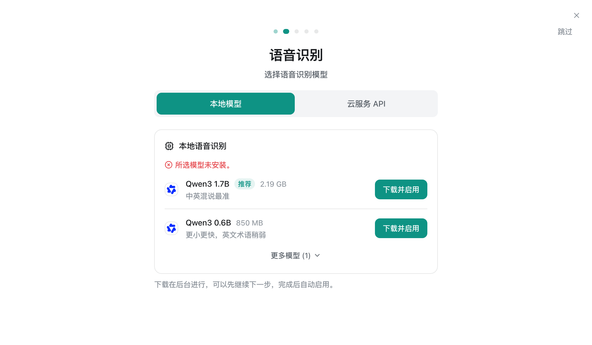
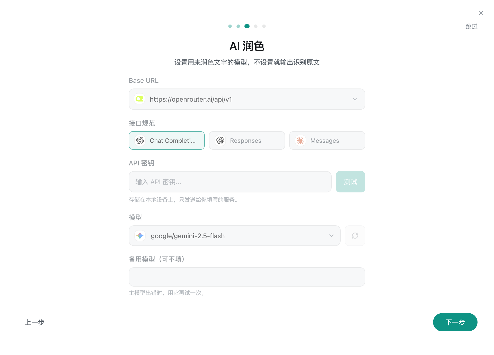
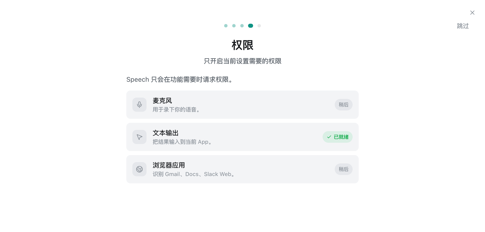
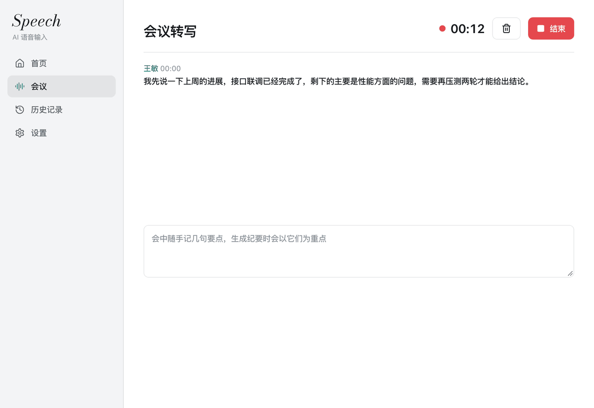
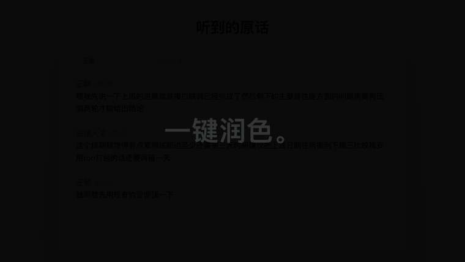
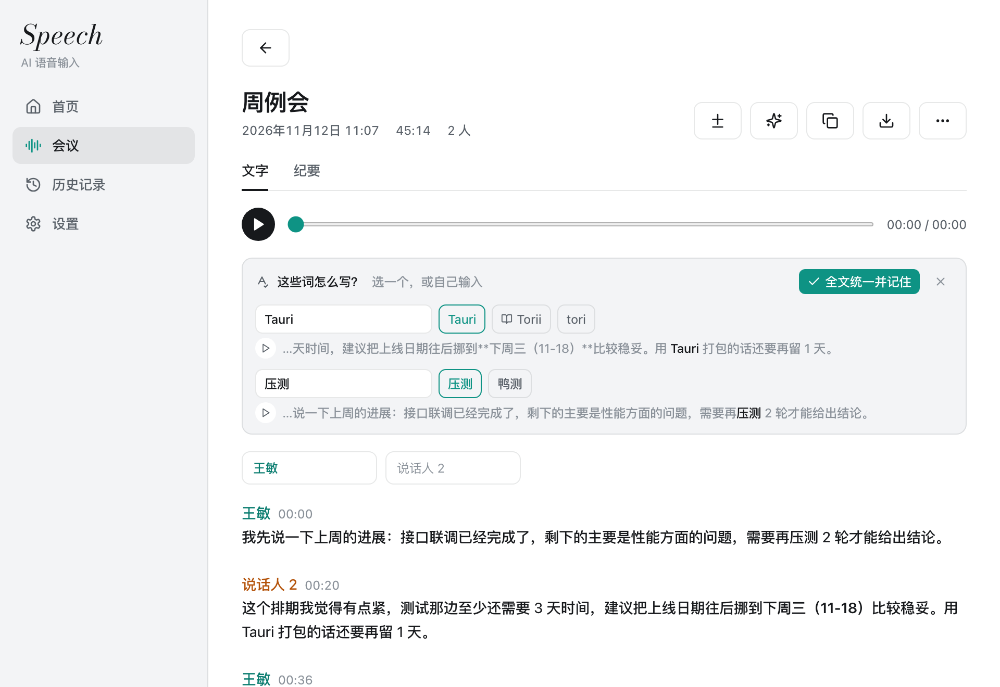
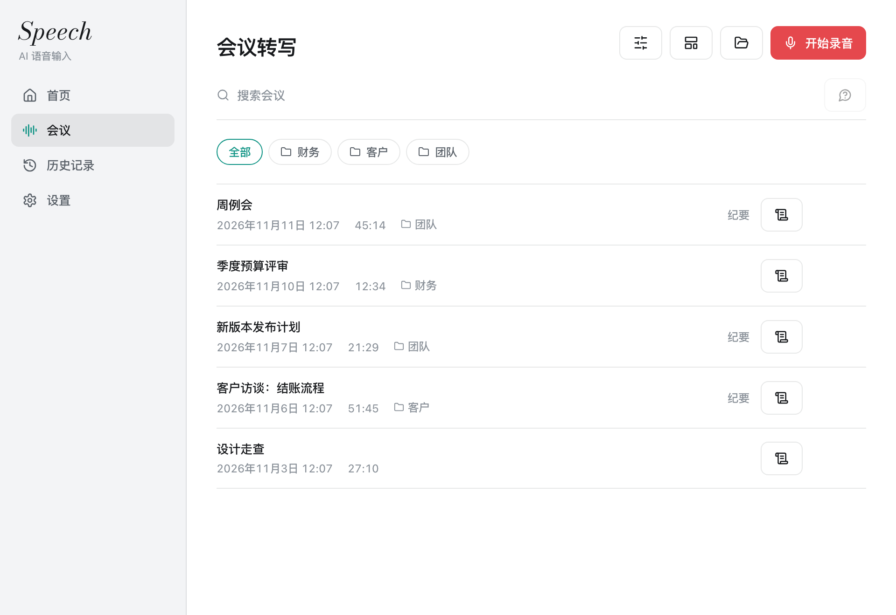

<p align="center">
  <a href="README.md">English</a> | <strong>中文</strong>
</p>

<p align="center">
  
</p>

<h1 align="center">Speech</h1>

<p align="center">在你自己电脑上运行的语音输入和会议纪要。</p>

<p align="center">
  <a href="https://github.com/PenguinMiaou/Speech/releases/latest/download/Speech-macos-arm64.dmg"><strong>下载 macOS 版</strong></a>
  |
  <a href="https://github.com/PenguinMiaou/Speech/releases/latest/download/Speech-windows-x64-setup.exe"><strong>下载 Windows 版</strong></a>
</p>

<p align="center">
  
</p>

按住快捷键说话，文字直接输入到你正在用的应用里。语音识别在你的电脑上完成，只有识别出来的文字会发给大模型做整理，用哪个模型、用谁的密钥由你决定。没有账号，没有遥测。

## 上手

### 1. 安装

|         |                                                                                                                                                    |
| ------- | -------------------------------------------------------------------------------------------------------------------------------------------------- |
| macOS   | 打开 [`.dmg`](https://github.com/PenguinMiaou/Speech/releases/latest/download/Speech-macos-arm64.dmg)，把 Speech 拖到“应用程序”。需要 Apple 芯片。 |
| Windows | 运行[安装包](https://github.com/PenguinMiaou/Speech/releases/latest/download/Speech-windows-x64-setup.exe)，或解压发布页里的免安装包。             |

以后的新版本在应用里直接更新。

### 2. 选一个语音识别模型

第一次打开会进入引导。在推荐的模型上点**下载并启用**，之后识别都在本机完成。

<p align="center">
  
</p>

### 3. 接上润色模型

选服务、贴密钥、点**测试**。支持 OpenAI Chat Completions、OpenAI Responses 和 Anthropic Messages 三种接口的服务都能用；用 Ollama 时什么都不离开本机。跳过这一步则直接输入识别原文。

<p align="center">
  
</p>

### 4. 允许麦克风和文字输出

<p align="center">
  
</p>

### 5. 按住快捷键说话

把光标放在任何地方，按住首页显示的快捷键，说话，松开。

<p align="center">
  
</p>

语气词和说错重说的部分会去掉，按想到的顺序说出来的话会排成写下来该有的顺序。还可以用语音改写选中的文字、提问，或者把说的话翻译出来。

## 会议

### 录音，或者拖入文件

打开**会议**点**开始录音**，或者把音频、视频文件拖进来。文字边说边出，每段标着说话人。

<p align="center">
  
</p>

### 一键润色全文

星形按钮让润色模型把全文改一遍，旁边的按钮显示改了哪里。

<p align="center">
  
</p>

### 确认拿不准的词

模型拿不准的词会带着出处的那句话、一个播放那一刻的按钮和几种写法供你选。选定的写法改遍全文，并记进词典。

<p align="center">
  
</p>

### 纪要和文件夹

**生成纪要**按模板写出决定和待办，每一条都能跳到录音里的那一刻。文件夹把每个客户、每个团队的会议放在一起。

<p align="center">
  
</p>

## 哪些数据会离开本机

| 数据                             | 去向                                           |
| -------------------------------- | ---------------------------------------------- |
| 录音                             | 用本地模型时不离开本机；否则发给你选的语音服务 |
| 识别出的文字                     | 发给你配置的润色模型；关掉润色时不离开本机     |
| 光标前的文字、从输入框读回的文字 | 不离开本机，只在内存里供本机识别和学习使用     |
| 声音样本、词典、历史记录、设置   | 存在本机                                       |
| API 密钥                         | 存在系统钥匙串或凭据管理器里                   |

应用启动时会向 GitHub 查询有没有新版本，可以在“设置 > 关于”里关掉。

## 更多

**[Speech 的全部功能详解](docs/FEATURES_zh.md)**：说话人和记住的声音、逐字时间、字幕、实时翻译、从你的修改里学习、更新方式，以及每项功能把什么发到哪里。

<details>
<summary>本地模型</summary>

| 模型                          | 大小    | 说明                   |
| ----------------------------- | ------- | ---------------------- |
| Qwen3-ASR 1.7B（Q8）          | 2.19 GB | 推荐，中英混说最准     |
| Qwen3-ASR 0.6B（Q8）          | 850 MB  | 更小更快，英文术语稍弱 |
| Qwen3-ASR 1.7B（F16）         | 4.09 GB |                        |
| MOSS Transcribe Diarize（Q8） | 987 MB  |                        |
| Cohere Transcribe（Q8）       | 2.41 GB |                        |
| Voxtral Mini 4B（Q8）         | 4.73 GB |                        |
| Nemotron 3.5 0.6B（Q8）       | 751 MB  |                        |

在 Apple 芯片的笔记本上，6 秒的录音约 0.7 秒识别完。也可以用自己的密钥走云端识别：Deepgram、AssemblyAI、阿里云、火山引擎、GLM、OpenAI、Groq、SiliconFlow、任何兼容 OpenAI 的 Whisper 服务，以及 macOS 上的 Apple 语音识别。

</details>

<details>
<summary>平台</summary>

| 平台                  | 状态                                                                                  |
| --------------------- | ------------------------------------------------------------------------------------- |
| macOS，Apple 芯片     | 日常使用中。本地识别用 Metal 加速                                                     |
| Windows 10 和 11，x64 | 发布页提供安装包和免安装压缩包。本地识别使用 Vulkan。读回输入框和录音时静音还没有实现 |
| Linux                 | 原项目支持。这个分支新增的部分没有在上面运行过                                        |

</details>

<details>
<summary>从源码构建</summary>

需要：Node 20、Rust 1.82 或更新、CMake，以及你的系统对应的 [Tauri 2 依赖](https://tauri.app/start/prerequisites/)。

```bash
npm ci
npm run tauri dev      # 开发模式运行
npm run tauri build    # 构建应用
```

构建时会先编译识别进程（`stt-worker/`）并打进应用，还会下载声音过滤用的 sherpa-onnx 预编译库。

在 macOS 上用固定的签名身份构建，重新编译后辅助功能和麦克风权限才不会失效：

```bash
APPLE_SIGNING_IDENTITY="<你的签名身份>" npm run tauri build -- --bundles app
```

测试：

```bash
npm test
cargo test --manifest-path src-tauri/Cargo.toml --lib
(cd stt-worker && cargo test)
```

</details>

## 许可证

Speech 是 [OpenTypeless](https://github.com/tover0314-w/opentypeless) 的分支，去掉了原项目的线上服务、账号和付费套餐。和原项目一样是 MIT，见 [LICENSE](LICENSE) 和 [THIRD_PARTY_NOTICES.md](THIRD_PARTY_NOTICES.md)。
