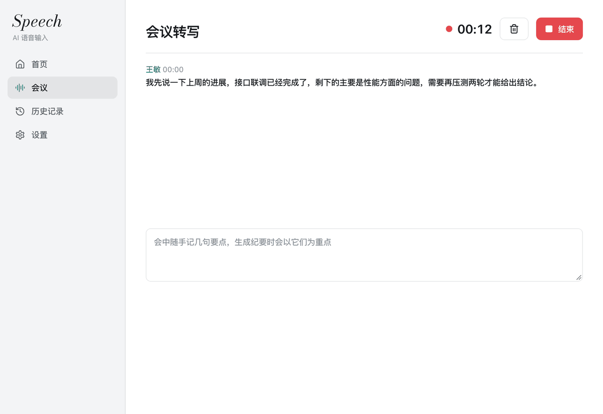
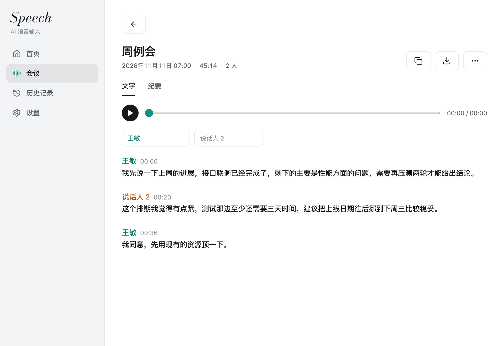

# Speech 功能详解

[回到 README](../README_zh.md)

## 能做什么

- **在任何应用里听写。** 按住或按一下快捷键，说话，松开，文字插入到光标处。
- **大模型整理。** 去掉语气词、说错重说的部分和口头改口，几件事自动排成分点，按想到的顺序说出来的话会排成写下来该有的顺序，原话和每个事实都保留。可以关掉润色，关掉后直接输入识别原文。
- **用语音改写选中的文字。** 选中文字，说出要求，选中的内容被替换。
- **用语音提问**，在浮动便签里得到简短回答。
- **翻译**，把说的话翻成一种或多种目标语言。
- **场景和按应用的写作风格**，可以写自己的提示词模板。
- **个人词典**，支持从文件导入。

## 会议

  

“会议”页可以直接录一段会议，也可以选择或拖入音频、视频文件（mp3、m4a、wav、flac、ogg、mp4、mov、mkv，最长 3 小时），用本机模型转成文字。

- **边说边出字。** 正在说的话大约每秒以灰色的临时文字出现，说满 6 秒后在第一个停顿处定稿，一直不停顿则在 20 秒时定稿。机器慢时临时文字会变少或不出。某一小段识别失败会重试，仍失败则跳过，后面的照常转写。
- **边录边改。** 点已定稿的文字就能改，录音中和会后都可以。改对的词会进词典，本场会议接下来的识别也会留意这个词。
- **会议语言。** 录音前或录音中都可以指定会议用的语言，最多三种；不指定时由模型自己判断。
- **区分说话人。** 模型装好后“区分说话人”默认打开，每段带说话人和开始时间，每个人一种颜色。第一次打开会在应用里下载三个共 143 MB 的模型。转文件时，由一个模型（NVIDIA Nemotron-3-Diarization）跟着最多八个说话人听完整段录音，同一个人从头到尾是同一个编号；正在录的会议也由它边录边听，每到一个停顿就给出到那里为止是谁在说。
- **按名字记住声音。** 给说话人填上名字后，应用会在本机记住这个声音，以后的会议里同一个人自动换上名字。记住的声音列在“选项”里，可以删除。
- **通话里自动认出自己。** 录了电脑声音时，只从麦克风进来、而别人从电脑里出来的那个说话人会标成“我”，这个声音已有名字时用原来的名字。
- **点字跳到那一刻。** 点录音会议里的任意一个字，播放位置跳到那里；播放时段落里会显示读到了哪。字的时间由前后片段的时间推算，误差在几秒之内。打开“逐字时间”后，录音结束时会用另一个能给出每个字时间的识别模型把录音再听一遍（SenseVoice small，FunASR 模型许可，sherpa-onnx 格式；第一次下载 240 MB），把它的时间对到已经写出的文字上。全程在本机运行，Apple M 系列芯片上十分钟录音约需二十秒。
- **导出字幕。** 带时间的文字除了纯文本、Markdown 和 Word，还能存成 SRT 或 WebVTT，每个片段一条，带说话人名字。
- **去掉没人说过的重复。** 遇到噪音或静音时识别模型有时会把同一句话反复写出来；连续出现三次的短语、连续八次的单字只保留一次。
- **一次转多个文件。** 拖入或选择多个录音，会一个接一个转成文字，每个存成一场独立的会议。
- **通话双方都录到。** 打开“同时录电脑声音”后，电脑播放的声音会和麦克风一起录下来（需要 macOS 14.6 或 Windows 10 以上）。
- **录音中途换设备不断。** 麦克风断开或换了别的麦克风时接着用新的录，中间没有麦克风的时间补成静音，电脑声音照常录；声音输出换到耳机或换回扬声器时，电脑声音跟着换过去。
- **外放时别人不录两遍。** 用扬声器开会时，麦克风里只有扬声器传回来的那部分会被调低；戴耳机时不做这一步（耳机检测仅 macOS）。
- **录音跟着会议保存。** 可以在应用里播放：还没播到的文字是灰色，点文字会把进度移到那一段，点时间会从那一刻开始播放，也可以另存出来或整段重新转写。录音保留到你删除录音或删除会议为止。
- **纪要和提问。** “生成纪要”按模板写成纪要，模板可以用自带的（通用、按章节、一对一、面试访谈、讲座分享、站会），或者导入 Markdown、文本文件。会中随手记的笔记会作为纪要的重点；每一行都带上起笔时的时间，会后点一下就跳到录音的那个位置。录音可以暂停再继续。纪要的长短随会议而定，区分结论和讨论，待办写成可勾选的条目，结论和待办带时间，点一下跳到录音的那个位置。纪要可以手动修改。也可以针对一场会议提问，按内容搜索过往会议，或者对最近二十场会议一起提问。
- **整理全文和标题。** 星形按钮让润色模型把全文改一遍（听错的词、标点、断句），并参考你词典里的写法；可以撤销，也可以设成录音结束后自动进行。没有起名的会议，会由润色模型根据文字起一个标题：短会议看全文，长会议看开头、中间和结尾。
- **润色前后对照。** 整理后的全文照常可以点字跳转、双击修改；星形按钮旁边的按钮显示改了什么（删掉的词灰色划掉，加上的词用强调色），“⋯”菜单可以恢复原文。原文跟着会议保存，以后打开也能对照。
- **拿不准的词让你选。** 模型拿不准写法的词会列出来：每个词带着出处的那句话和一个从那里播放录音的按钮，几种写法和你词典里写得相近的词可以直接选，也可以自己输入。选定的写法会改遍全文并进词典，这个列表可以从工具栏再打开。
- **文件夹。** 在列表里把会议放进文件夹；文件夹排在列表上方，点一个只看其中的会议，新会议进入当前选中的文件夹。
- **实时翻译。** 打开“实时翻译”后，每段定稿的文字会被翻译，显示在原文下面。
- **导出。** 文字和纪要可以存为纯文本、Markdown 或 Word 文档。

  

识别、区分说话人和声音匹配都在本机完成。纪要、提问、整理全文和实时翻译会把会议文字连同你记的笔记发送给设置里的润色模型；生成纪要时还会带上词典里最新的八十个词，对所有会议提问时会发送最近二十场会议的纪要（没有纪要的发送开头部分的文字）。配置了润色模型时，会议结束后还会把最多 6000 字发给它一次，用来起标题（短会议是全文，长会议取开头、中间和结尾各一段）。没有配置润色模型时，会议文字不会离开本机。录音被中断（比如应用崩溃）时，下次启动会找回这段录音、已经转出的文字和当时记的笔记。录音结束后，会在本机用整段录音重新区分一次发言人，比边录边分更稳。应用在数据目录里写一份只含状态和错误的日志（设置里可以打开），日志不含说话或输入的内容。纪要写好后会用纪要重新起一次标题，你自己改过的标题不会动。在设置里打开模型列表时，会向列出的每个模型发一个单词的请求来测时延，显示在模型右边，并按快慢排序。识别时会参考你词典里的词，录音时切到别的页面也不会中断。

## 这个分支新增的

- **本机语音识别。** 在设置页一键下载模型，下载后核对 SHA-256 才启用。识别在单独的进程里运行，空闲后自动退出。
- **给识别引擎上下文。** 最新的 30 个词典词、同一应用里最近几句听写（只在内存里保留 10 分钟）、光标前最多 200 个字，都会交给本机的识别引擎。从屏幕上读到的文字不会发给任何云服务。
- **从你的修改里学习。** 听写后最多观察输入框一分钟。你手动改正的词会连同它原来被听成什么一起进词典。不读密码框，输入框的文字只在内存里比对，不保存。
- **按应用的排版习惯。** 如果你在某个应用里总是删掉句末句号或把分行合并，之后润色在这个应用里就不再加。只保存次数。
- **只识别我的声音。** 可选的过滤，识别前保留已登记的说话人、去掉旁人的声音。使用 VoxLock 模型（Apache-2.0），通过 sherpa-onnx 运行，需要一段至少 3 秒的声音样本，样本只存在本机。装了区分说话人的模型后，听写结束时先分出说话人，再把每个人的声音和样本比对，只识别像样本的那个人说的部分；没有人像样本时什么都不输出。
- **麦克风。** 可以指定麦克风，选中的麦克风没声音时自动换，录音时静音电脑的声音输出（macOS）。
- **备用润色模型**，主模型出错时用它再试一次。

## 本地模型

| 模型                          | 大小    | 说明                   |
| ----------------------------- | ------- | ---------------------- |
| Qwen3-ASR 1.7B（Q8）          | 2.19 GB | 推荐，中英混说最准     |
| Qwen3-ASR 0.6B（Q8）          | 850 MB  | 更小更快，英文术语稍弱 |
| Qwen3-ASR 1.7B（F16）         | 4.09 GB |                        |
| MOSS Transcribe Diarize（Q8） | 987 MB  |                        |
| Cohere Transcribe（Q8）       | 2.41 GB |                        |
| Voxtral Mini 4B（Q8）         | 4.73 GB |                        |
| Nemotron 3.5 0.6B（Q8）       | 751 MB  |                        |

用 76 段留出的真实听写录音测试（以中文为主，夹英文术语），Qwen3-ASR 1.7B 和参考文本的字符相似度是 0.83，122 个技术术语认对 91 个。在 Apple 芯片的笔记本上，6 秒的录音约 0.7 秒识别完，12 秒的约 1.3 秒。

原项目的云端识别仍然可用，填自己的密钥即可：Deepgram、AssemblyAI、阿里云 Qwen3 ASR、火山引擎豆包、GLM ASR、OpenAI Whisper、Groq Whisper、SiliconFlow、任何兼容 OpenAI 接口的 Whisper 服务，以及 macOS 上的 Apple 语音识别。

## 润色模型

润色支持 OpenAI Chat Completions、OpenAI Responses、Anthropic Messages 三种接口的任何服务。内置了智谱、DeepSeek、SiliconFlow、OpenAI、Gemini、Moonshot、豆包、通义千问、Groq、Claude、OpenRouter 和 Ollama 的预设。用 Ollama 时没有任何内容离开本机。

## 哪些数据会离开本机

| 数据                             | 去向                                           |
| -------------------------------- | ---------------------------------------------- |
| 录音                             | 用本地模型时不离开本机；否则发给你选的语音服务 |
| 识别出的文字                     | 发给你配置的润色模型；关掉润色时不离开本机     |
| 光标前的文字、从输入框读回的文字 | 不离开本机，只在内存里供本机识别和学习使用     |
| 声音样本、词典、历史记录、设置   | 存在本机                                       |
| API 密钥                         | 存在系统钥匙串或凭据管理器里                   |

没有账号，没有遥测。启动时应用会向 GitHub 询问有没有新版本，可以在“设置 > 关于”里关掉。

## 更新

应用启动时会检查有没有新版本，有的话在窗口顶部提示，可以在“设置 > 关于”里关掉，那里也有手动检查的按钮。在 Windows 上，应用只下载有变化的程序文件，逐个核对发布页列出的 SHA-256 后替换，下载时显示进度。点“立即重启”后新版本生效。模型、设置和历史记录不受影响。在 macOS 上，应用下载整个已签名的应用，核对发布页列出的 SHA-256 和当前应用的签名后替换原位置的应用，已授予的权限保留。无法原地替换时（比如直接从磁盘映像里运行），改为打开发布页。

首页会显示润色模型报告的 token 用量（今天、近 30 天、累计）。数字只记在本机，服务商不报告用量时不显示。

“词典 > 片段”里可以存短语和对应文字：单独说出短语，就原样输入那段文字，不经过润色模型。

在 macOS 上，应用会看你听写后怎么改：把“您”改成“你”或反过来、删掉感叹号、中英文之间加不加空格、句末句号、分不分行。同一个应用里同样的改法出现五次以上，之后的润色就照这个习惯来。只记次数，不存文字，“词典”页可以逐条忘掉。

“设置 > AI 润色 > 高级润色设置”里可以选中文字形（简体或繁体）和标点方式（自动、只加说出来的标点、不加）。“设置 > 通用 > 更多设置”里有边生成边写入、剪贴板和历史保留的选项，以及三个额外快捷键：用说的改选中文字、切换场景、打开主窗口。“设置 > 关于”里有状态检查。

## 平台

| 平台                  | 状态                                                                                  |
| --------------------- | ------------------------------------------------------------------------------------- |
| macOS，Apple 芯片     | 日常使用中。本地识别用 Metal 加速                                                     |
| Windows 10 和 11，x64 | 发布页提供安装包和免安装压缩包。本地识别使用 Vulkan。读回输入框和录音时静音还没有实现 |
| Linux                 | 原项目支持。这个分支新增的部分没有在上面运行过                                        |
